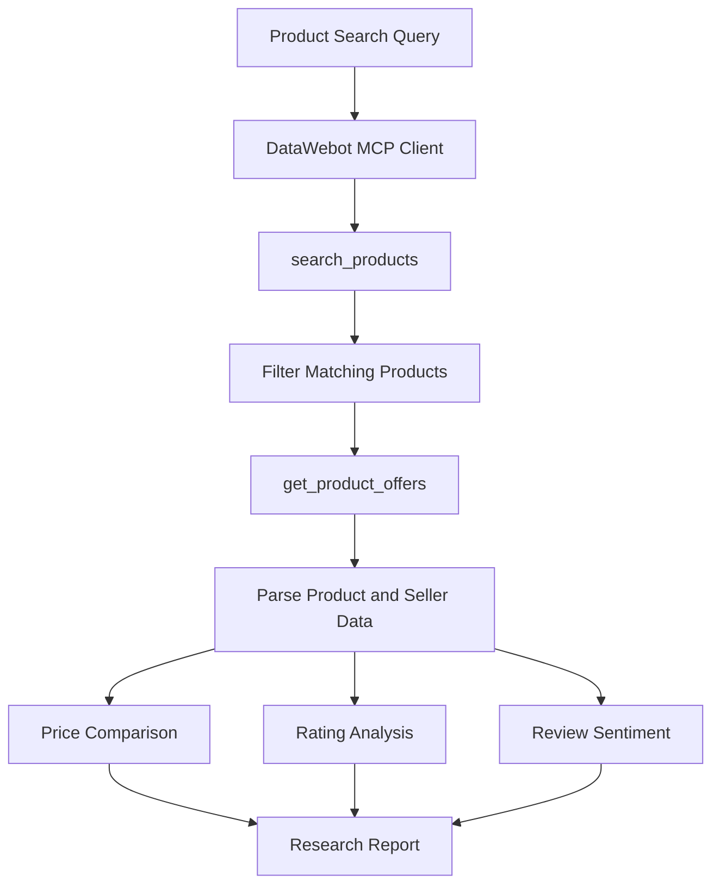

# Price

**A Python product research tool powered by DataWebot MCP.**

Price searches for products across online stores, collects available seller offers and helps compare prices, ratings and customer reviews in one place.

I built this project to explore how MCP can be used in a real application. Rather than simply calling an external tool and displaying its response, I wanted to take the returned ecommerce data, process it and turn it into something useful for comparing products.

> An independent developer project built using DataWebot. This is not an official DataWebot product.

[DataWebot](https://datawebot.com/) · [MCP Documentation](https://datawebot.com/docs/agents) · [GitHub Repository](https://github.com/0DevDutt0/Price)

---

## What does it do?

Given a product name, Price searches for matching products and retrieves the available seller information.

It then:

- Searches for products using DataWebot's `search_products` tool.
- Retrieves seller offers using `get_product_offers`.
- Compares available seller prices and shipping information.
- Finds the lowest reported offer.
- Ranks products using their ratings and review counts.
- Analyzes available customer reviews using rating distributions or VADER.
- Displays seller links and retrieval timestamps alongside the results.

The goal is to make product research easier while keeping the comparison logic transparent.

## How it works

The application follows a fairly straightforward workflow:



### Research workflow

1. Enter a product name and select a country.
2. Price sends the search request to DataWebot.
3. It filters the returned products to find those with available seller offers.
4. It retrieves seller information for the selected products.
5. The responses are converted into structured Python objects.
6. Price and review information are processed using Python.
7. The application identifies the cheapest offer and best-reviewed product.
8. The results are displayed in the terminal.

The workflow is sequential. Product ranking and comparison are handled through Python logic rather than an LLM.

## Technology stack

| Technology | How it is used |
|---|---|
| Python | Main application and business logic |
| DataWebot MCP | Product discovery and seller information |
| HTTPX | HTTP communication |
| JSON-RPC 2.0 | MCP request and response handling |
| Dataclasses | Structured product and offer data |
| VADER | Review sentiment analysis |
| Pytest | Automated testing |

I kept the implementation relatively lightweight and wrote a direct MCP client using HTTPX instead of introducing a larger agent framework. This keeps the external integration separate from the rest of the application and makes it easier to test.

## A closer look at the implementation

### MCP integration

Price communicates with DataWebot's remote MCP server using HTTPX and JSON-RPC 2.0.

The client handles authentication, tool requests, response parsing, timeouts and API errors.

I wanted to understand what happens behind a tool call, so I kept the communication layer explicit rather than hiding it behind an additional framework.

### Product and offer processing

External API responses are converted into Python dataclasses before being passed to the comparison logic.

This keeps the provider-specific response handling separate from the actual product research.

The application works with information such as:

- Product names and identifiers.
- Seller names and product links.
- Listed prices and currencies.
- Shipping information.
- Ratings and review counts.
- Available review text and sentiment information.

Only fields returned by the provider can be used in the comparison.

### Price comparison

The application compares seller offers using the reported total when available. Otherwise, it attempts to calculate a total from the product price and available shipping information.

The seller with the lowest reported total is selected.

There is one limitation worth mentioning: when shipping information is missing, the current implementation treats it as zero. This can affect the comparison, so the result should not be treated as a guaranteed checkout price.

### Review-based ranking

A product with a perfect rating from two reviews should not automatically rank above a product with a slightly lower rating supported by hundreds of reviews.

To account for this, Price uses a weighted rating formula:

$$
R_{\text{adjusted}} =
\frac{nR + 20(4.0)}{n+20}
$$

Where:

- `R` is the average product rating.
- `n` is the number of reviews.
- `4.0` is the assumed prior average.
- `20` is the weight assigned to the prior.

This gives products with more review data a stronger influence on the ranking.

It is a simple Bayesian-style ranking approach, not a machine-learning model.

### Review sentiment

Price uses the review information returned by DataWebot.

When a star-rating breakdown is available, reviews are grouped into positive, neutral and negative categories.

When that information is unavailable but review text is returned, VADER is used to classify the available text.

The two approaches serve as alternatives depending on the information available from the provider. VADER results represent the returned review sample, not every customer review.

## Getting started

### Requirements

- Python 3.9 or newer
- pip
- A DataWebot account and API key

### 1. Clone the repository

```bash
git clone https://github.com/0DevDutt0/Price.git
cd Price
```

### 2. Create a virtual environment

**Windows (PowerShell)**

```powershell
py -m venv .venv
.venv\Scripts\Activate.ps1
```

**Linux / macOS**

```bash
python3 -m venv .venv
source .venv/bin/activate
```

### 3. Install dependencies

```bash
python -m pip install -r requirements-dev.txt
```

### 4. Configure DataWebot authentication

The application supports an environment variable and a saved credentials profile.

**Windows (PowerShell)**

```powershell
$env:DATAWEBOT_API_KEY = "YOUR_DATAWEBOT_API_KEY"
```

**Linux / macOS**

```bash
export DATAWEBOT_API_KEY="YOUR_DATAWEBOT_API_KEY"
```

Alternatively, credentials can be loaded from:

```text
~/.datawebot/credentials
```

The environment variable takes precedence over the saved credentials.

Keep your API key private. Never commit credentials or `.env` files to the repository.

## Usage

Search for a product:

```bash
python -m price_agent "Apple AirPods Pro 2"
```

Search a specific market:

```bash
python -m price_agent "Sony WH-1000XM5" --country US
```

Limit the number of products:

```bash
python -m price_agent "Sony WH-1000XM5" --country US --limit 3
```

Search the Indian market:

```bash
python -m price_agent "Sony WH-1000XM5" --country IN --limit 3
```

### Available arguments

| Argument | Description | Default |
|---|---|---|
| `query` | Product to search for | Required |
| `--country` | Two-letter country code | `US` |
| `--limit` | Maximum number of products for seller lookups | `3` |

To see the available options:

```bash
python -m price_agent --help
```

## Testing

I included tests for the main application components.

Run the test suite with:

```bash
python -m pytest
```

The tests cover:

- Authentication and credential loading.
- JSON-RPC requests and responses.
- Network and API errors.
- Product search and seller-offer retrieval.
- Price parsing and comparison.
- Rating calculations and sentiment analysis.
- CLI arguments and terminal output.

HTTP requests are mocked during testing, and real HTTP requests are blocked. This means the tests can run without connecting to DataWebot or consuming API usage.

## Project structure

```text
Price/
│
├── price_agent/
│   ├── __init__.py
│   ├── __main__.py
│   ├── agent.py
│   ├── cli.py
│   ├── datawebot.py
│   ├── models.py
│   ├── pick.py
│   └── sentiment.py
│
├── tests/
│   ├── conftest.py
│   ├── test_agent.py
│   ├── test_cli.py
│   ├── test_datawebot.py
│   └── test_pick.py
│
├── requirements.txt
├── requirements-dev.txt
└── README.md
```

| File | Responsibility |
|---|---|
| `agent.py` | Coordinates the product research workflow |
| `cli.py` | Handles arguments and terminal output |
| `datawebot.py` | Handles MCP communication and authentication |
| `models.py` | Defines product and seller-offer structures |
| `pick.py` | Handles price parsing and product ranking |
| `sentiment.py` | Performs review sentiment analysis |
| `__main__.py` | Application entry point |
| `tests/` | Automated tests |

## Known limitations

There are still some things I would like to improve:

- Missing shipping costs are not reliably distinguished from free shipping.
- Currency conversion is not implemented.
- Product variants and conditions are not independently verified.
- Product matching relies on the results returned by DataWebot.
- Review sentiment is limited to the information available from the provider.
- Prices and stock availability can change after retrieval.
- There is no persistent price history or automatic price-drop monitoring.
- There is no web interface or database.
- The application does not submit paid DataWebot extraction Jobs.

Price currently focuses on product research and comparison rather than purchasing or independently scraping ecommerce websites.

## What I would like to improve next

Some areas I would like to work on:

- Better handling of missing shipping and currency information.
- More reliable product and variant matching.
- Stronger validation of external API responses.
- More test cases using realistic provider responses.
- Automated testing through GitHub Actions.
- Historical price tracking and price-drop notifications.
- A web interface for comparing products.

## Why I built this

I wanted to build something practical with MCP and understand how an external data service could fit into a working application.

Price gave me an opportunity to work with an actual ecommerce data source, build a custom integration, process the returned information and implement my own comparison logic.

It also brought up some interesting engineering problems: dealing with incomplete data, parsing different price formats, handling API failures and testing an external integration without depending on live requests.

The project is still evolving, and I see plenty of room to make the comparisons more accurate and the application more useful.

## References

- [DataWebot – Official Website](https://datawebot.com/)
- [DataWebot – MCP Documentation](https://datawebot.com/docs/agents)
- [DataWebot – Developer Documentation](https://datawebot.com/docs)
- [DataWebot – Careers](https://datawebot.com/careers)

---

**Built with Python · Powered by DataWebot MCP**
