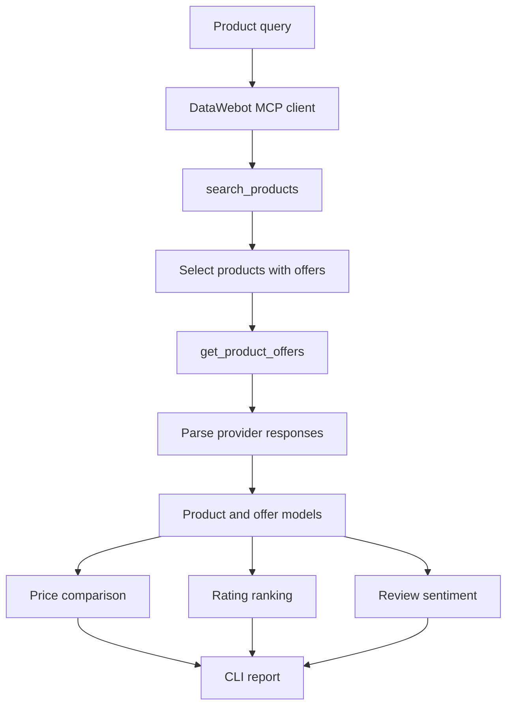

# Price

**A Python product research tool built with DataWebot MCP.**

Price searches for products across online stores, retrieves available seller offers and turns the results into a comparison that is easy to inspect. It looks at seller prices, available shipping information, product ratings and review sentiment.

I built it to explore what it takes to turn an ecommerce MCP integration into a useful application: making tool calls, handling the responses, applying consistent comparison logic and testing the parts that depend on an external service.

> Independent developer project built using DataWebot. This is not an official DataWebot product.

[DataWebot](https://datawebot.com/) · [MCP documentation](https://datawebot.com/docs/agents) · [Repository](https://github.com/0DevDutt0/Price)

---

## What it does

Give Price a product query and it will:

- Search for matching products using DataWebot's `search_products` tool.
- Retrieve available seller offers using `get_product_offers`.
- Compare the returned offers and identify the lowest reported total.
- Rank products using their average ratings and review counts.
- Summarize review sentiment from a star-rating breakdown or, when that is unavailable, from returned review text using VADER.
- Show seller links and retrieval information where the provider returns them.

The application is a command-line tool. Its research and ranking steps run sequentially and use Python logic; it does not use an LLM to make the comparison.

## How the workflow fits together



1. The CLI accepts a product query, country and result limit.
2. The application searches DataWebot for matching products.
3. It selects search results that have product identifiers needed for seller-offer lookup.
4. It requests seller offers for the selected products.
5. Provider responses are parsed into the application's product and offer models.
6. The comparison logic processes the available prices, ratings and review information.
7. The CLI prints the research results, including the cheapest reported offer and best-reviewed product when enough data is available.

## What the implementation demonstrates

### Direct MCP integration

The DataWebot client uses HTTPX to send JSON-RPC 2.0 tool calls to the remote MCP endpoint. The client is responsible for authentication, request construction, timeouts, response parsing and API error handling.

I kept this communication layer separate from the research logic. That makes it easier to test API behaviour without coupling every part of the application to HTTP requests.

### Structured data processing

The application converts provider responses into Python dataclasses before the comparison logic uses them. Product and seller-offer parsing is kept separate from the CLI output, so the same data can be processed without depending on terminal formatting.

### Price comparison

The application uses a seller's reported total when one is available. Otherwise, it calculates a comparison total from the listed price and the shipping information it can parse.

The offer with the lowest resulting total is selected. This is a comparison of the information returned by the provider, not a guarantee of the final checkout amount.

### Review-count-weighted ranking

A high rating backed by only a few reviews should carry less weight than a similar rating backed by a much larger sample. Price uses this weighted-rating formula:

\[
R_{adjusted} = \frac{nR + 20(4.0)}{n + 20}
\]

Where:

- `R` is the reported average rating.
- `n` is the reported review count.
- `4.0` is the assumed prior rating.
- `20` is the prior weight.

This is a small Bayesian-style ranking heuristic, not a trained recommendation model.

### Review sentiment

The application uses the review information available in the provider response:

- When a star-rating breakdown is available, it groups 4–5 stars as positive, 3 stars as neutral, and 1–2 stars as negative.
- When a breakdown is unavailable but review text is returned, it uses VADER to classify that text.

The text-based result only describes the reviews returned for that request. It should not be read as an analysis of every review for the product.

## Technology

| Technology | Use |
|---|---|
| Python | Application logic and orchestration |
| DataWebot MCP | Product search and seller-offer data |
| HTTPX | HTTP transport |
| JSON-RPC 2.0 | MCP tool communication |
| Python dataclasses | Product and offer models |
| VADER | Review-text sentiment analysis |
| Pytest | Automated tests |

The project uses a small direct MCP client rather than LangChain or LangGraph. That is a deliberate choice for this application: its workflow is a short sequence of tool calls followed by deterministic processing, so a larger agent framework is not needed.

## Testing

The test suite covers the main boundaries and comparison logic:

- Credential loading and authentication behaviour.
- JSON-RPC requests, responses and API errors.
- Product-search orchestration and seller-offer retrieval.
- Price parsing and offer comparison.
- Rating calculations and sentiment handling.
- CLI argument validation and report formatting.

The tests use mocked HTTP transports and fake clients. Real HTTP requests are blocked during tests, so the suite does not need a live DataWebot connection.

Run the tests with:

```bash
python -m pytest
```

## Things I would improve next

Working with product data makes a few edge cases hard to ignore. These are known limitations in the current implementation, not problems the application has already solved.

- **Unknown shipping:** The current price calculation can treat missing shipping information as zero. It should distinguish unknown shipping from confirmed free shipping.
- **Currencies:** The application does not convert currencies or enforce same-currency comparisons. A comparison should not rank amounts from different currencies as if they were equivalent.
- **Product variants:** Similar titles do not guarantee that two listings represent the same model, generation or condition. Product identifiers and variant details need stronger validation.
- **Provider response changes:** The client calls the named tools directly. DataWebot recommends using `discover` to inspect the tools and their current input schemas; adding discovery and schema-aware handling would make the integration more resilient.
- **Price freshness:** DataWebot results are timestamped snapshots, not guaranteed-live or verified checkout prices. The application should keep that context visible and encourage users to verify the seller page.

Other possible additions include more response fixtures, automated CI, product-match evaluation cases and persistent price observations. Historical tracking and alerts would need storage and scheduling outside the current application.

## Run locally

### Requirements

- Python installed.
- Access to a DataWebot account and the credentials expected by the application.

### Clone the project

```bash
git clone --branch datawebot-agent https://github.com/0DevDutt0/Price.git
cd Price
```

### Create and activate a virtual environment

**Windows PowerShell**

```powershell
py -m venv .venv
.venv\Scripts\Activate.ps1
```

**Linux / macOS**

```bash
python3 -m venv .venv
source .venv/bin/activate
```

### Install dependencies

```bash
python -m pip install -r requirements-dev.txt
```

### Configure credentials

The application supports the credential sources implemented in its DataWebot client. Keep API credentials outside the repository and never commit them.

If using the environment-variable option:

**Windows PowerShell**

```powershell
$env:DATAWEBOT_API_KEY = "YOUR_DATAWEBOT_API_KEY"
```

**Linux / macOS**

```bash
export DATAWEBOT_API_KEY="YOUR_DATAWEBOT_API_KEY"
```

### Run a search

```bash
python -m price_agent "Sony WH-1000XM5" --country US --limit 3
```

See the available options with:

```bash
python -m price_agent --help
```

## Project structure

```text
Price/
├── price_agent/
│   ├── __init__.py
│   ├── __main__.py
│   ├── agent.py
│   ├── cli.py
│   ├── datawebot.py
│   ├── models.py
│   ├── pick.py
│   └── sentiment.py
├── tests/
│   ├── conftest.py
│   ├── test_agent.py
│   ├── test_cli.py
│   ├── test_datawebot.py
│   └── test_pick.py
├── requirements.txt
├── requirements-dev.txt
└── README.md
```

| File | Responsibility |
|---|---|
| `agent.py` | Coordinates the product research workflow |
| `cli.py` | Parses arguments and formats the report |
| `datawebot.py` | Handles MCP communication and authentication |
| `models.py` | Defines product and seller-offer models |
| `pick.py` | Parses prices and selects comparison results |
| `sentiment.py` | Handles review sentiment analysis |
| `__main__.py` | Application entry point |
| `tests/` | Tests the client, orchestration, parsing and CLI |

## Why I built it

I wanted to go beyond a minimal MCP connection example and build a small application around the data it returns. Price gave me a way to work through the full path: send tool requests, interpret provider responses, handle incomplete fields, compare offers and test the integration without relying on live network calls.

It also made the limits of a simple comparison clear. A low number is not automatically the best offer if shipping is unknown, the currency differs or the listing is a different product variant. Those are the areas I would focus on next.

## References

- [DataWebot website](https://datawebot.com/)
- [DataWebot MCP documentation](https://datawebot.com/docs/agents)
- [DataWebot developer documentation](https://datawebot.com/docs)
- [DataWebot careers](https://datawebot.com/careers)

---

**Built with Python · Integrated with DataWebot MCP**
