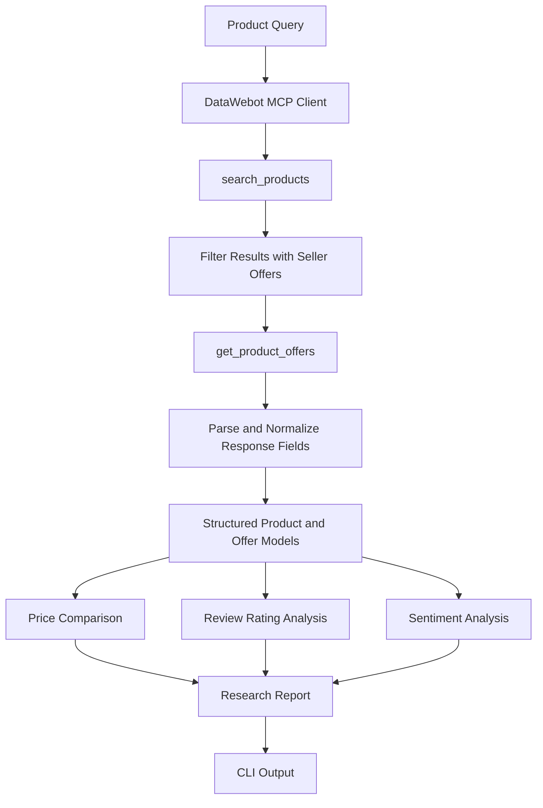

# Price

**An explainable product research agent built with Python and DataWebot MCP.**

Price explores how ecommerce data retrieved through DataWebot can be transformed into useful, transparent product comparisons. It searches products across online shops, retrieves seller offers, compares available prices, evaluates review ratings and summarizes review sentiment.

The project focuses on practical engineering: MCP integration, structured data processing, deterministic recommendation logic, API error handling and automated testing.

> **Independent developer project.** Built using DataWebot's MCP server. Not an official DataWebot product.

[DataWebot](https://datawebot.com/) · [MCP Documentation](https://datawebot.com/docs/agents) · [Repository](https://github.com/0DevDutt0/Price)

---

## Overview

Finding a product at the lowest listed price is not necessarily the same as finding the best buying option.

Different sellers may have different prices, shipping charges, ratings and review histories. Product information can also be incomplete or inconsistent.

Price brings the available information into a single research report.

### What it does

- **Product discovery:** Searches ecommerce listings through DataWebot's `search_products` MCP tool.
- **Seller comparison:** Retrieves seller offers through `get_product_offers`.
- **Price analysis:** Parses prices and compares seller totals when shipping information is available.
- **Review ranking:** Uses a review-count-weighted rating to reduce the influence of products with very few reviews.
- **Sentiment analysis:** Uses DataWebot's star-rating breakdown when available, otherwise applies VADER to returned review text.
- **Retrieval transparency:** Reports when product and seller information was retrieved.
- **Failure handling:** Handles authentication issues, rate limits, network failures and unsuccessful product lookups.

## How it works

A research request follows a sequential workflow:



### Execution flow

1. The user supplies a product query, target country and result limit.
2. The application sends a product-search request to DataWebot.
3. Search results are filtered to identify products with available seller offers.
4. Seller information is retrieved for up to the configured result limit.
5. API responses are converted into structured Python dataclasses.
6. Prices, review ratings and available sentiment information are processed.
7. The application selects the lowest-priced seller offer and the best-reviewed product.
8. A terminal report presents the findings, retrieval timestamps and any skipped results.

The orchestration is sequential and deterministic. It does not depend on an LLM to make purchasing recommendations.

## Technology stack

| Technology | Role |
|---|---|
| Python | Application logic and orchestration |
| DataWebot MCP | Ecommerce product discovery and seller data |
| JSON-RPC 2.0 | MCP tool communication |
| HTTPX | HTTP requests and transport |
| Python dataclasses | Structured product and seller-offer models |
| VADER | Rule-based review sentiment analysis |
| Pytest | Automated testing |

The MCP client sends JSON-RPC 2.0 `tools/call` requests directly to DataWebot's remote MCP endpoint using HTTPX.

This implementation does not rely on LangChain, LangGraph or an LLM framework.

## Engineering decisions

### 1. Direct MCP integration

The application implements a small DataWebot client instead of introducing a larger agent framework.

It handles:

- JSON-RPC 2.0 request construction.
- HTTP communication with the remote MCP endpoint.
- Bearer-token authentication.
- Response parsing and error handling.
- Explicit connection lifecycle management.
- Configurable request timeouts.

This keeps the integration relatively small and makes the external service boundary easy to test.

### 2. Structured product and offer models

External API responses are converted into Python dataclasses.

**Product**
- Product identifier and title.
- Available rating and review count.
- Seller offers.
- Review text and sentiment counts.
- Retrieval timestamp.

**Offer**
- Seller or shop name.
- Listed price and comparison total.
- Currency.
- Product URL.
- Shipping information.

This separates provider response parsing from recommendation and reporting logic.

### 3. Deterministic price comparison

The application uses the seller's reported total when available. Otherwise, it attempts to calculate the comparison total from the listed price and known shipping information.

The lowest reported total is used to identify the cheapest offer.

Unknown shipping is currently treated as zero when no total is supplied. This is a known limitation and means the result should not be interpreted as a guaranteed final checkout price.

### 4. Review-count-weighted ranking

A product with a perfect rating from a very small number of reviews should not automatically outrank a product with a slightly lower rating backed by many reviews.

Price uses the following adjustment:

```math
R_{adjusted} = \frac{nR + 20 \times 4.0}{n + 20}
```

Where:

- `R` is the product's average rating.
- `n` is its review count.
- `4.0` is the assumed prior average.
- `20` is the prior weight.

This is a Bayesian-style ranking heuristic, not a trained recommendation model.

Products without sufficient rating information are excluded from the best-reviewed selection.

### 5. Review sentiment

The application uses two sources of sentiment information:

**Provider rating breakdown**

When DataWebot supplies a star-rating breakdown, reviews are grouped as:

- Good: 4 and 5 stars.
- Neutral: 3 stars.
- Bad: 1 and 2 stars.

**VADER fallback**

When a star breakdown is unavailable but review text is returned, VADER classifies the available text as positive, neutral or negative.

The report identifies which source was used. VADER results represent the returned sample, not the sentiment of every customer review.

### 6. Isolated error handling and testing

The application uses structured application errors for authentication, rate limiting, network failures and malformed responses.

Tests use mocked HTTP transports and fake clients. Real HTTP requests are blocked during testing, preventing accidental calls to DataWebot and consumption of the account's daily allowance.

## Installation

### Requirements

- Python 3.9 or newer.
- pip.
- A DataWebot account and API key.

### 1. Clone the repository

```bash
git clone --branch datawebot-agent https://github.com/0DevDutt0/Price.git
cd Price
```

### 2. Create a virtual environment

**Windows (PowerShell)**

```powershell
py -m venv .venv
.venv\Scripts\Activate.ps1
```

**Linux / macOS**

```bash
python3 -m venv .venv
source .venv/bin/activate
```

### 3. Install dependencies

```bash
python -m pip install -r requirements-dev.txt
```

### 4. Configure DataWebot authentication

The application supports two credential sources.

**Option A: Environment variable**

Windows PowerShell:

```powershell
$env:DATAWEBOT_API_KEY = "YOUR_DATAWEBOT_API_KEY"
```

Linux / macOS:

```bash
export DATAWEBOT_API_KEY="YOUR_DATAWEBOT_API_KEY"
```

**Option B: Saved DataWebot credentials**

Sign in through DataWebot and use the saved credentials profile.

The application reads the API key from:

```text
~/.datawebot/credentials
```

The environment variable takes precedence over the saved profile.

Never commit API keys, credentials files or other secrets to Git.

## Usage

Run a product search:

```bash
python -m price_agent "Apple AirPods Pro 2"
```

Search a specific market:

```bash
python -m price_agent "Sony WH-1000XM5" --country US
```

Limit seller lookups:

```bash
python -m price_agent "Sony WH-1000XM5" --country US --limit 3
```

Search the Indian market:

```bash
python -m price_agent "Sony WH-1000XM5" --country IN --limit 3
```

### Command-line arguments

| Argument | Description | Default |
|---|---|---|
| `query` | Product search query | Required |
| `--country` | Two-letter market code | `US` |
| `--limit` | Maximum search results to open for seller offers | `3` |

The result limit must be between 1 and 10.

Use `--help` to view the available arguments:

```bash
python -m price_agent --help
```

## Understanding the results

Price reports the following information:

| Output | Meaning |
|---|---|
| Product title | Product name returned by DataWebot |
| Lowest seller | Seller with the lowest reported offer total |
| Product URL | Direct seller product-page link |
| Rating | Available average product rating |
| Review count | Number of reviews reported |
| Star breakdown | Good, neutral and bad review counts |
| VADER analysis | Sentiment classification of returned review text |
| Retrieval time | Timestamp supplied by DataWebot |
| Least price | Lowest offer across the returned products |
| Best reviewed | Product with the highest adjusted rating |

### Important interpretation rules

**Prices are snapshots, not guaranteed live prices.**

DataWebot returns best-effort results with retrieval timestamps. Prices, shipping charges and availability can change after retrieval.

**Shipping information may be incomplete.**

The current implementation uses the provider's stated total when present. When it calculates a total itself, unknown shipping is treated as zero. Verify shipping charges before making a purchase.

**Currency conversion is not implemented.**

The application does not convert currencies or perform foreign-exchange normalization. Compare products within the same market and verify the displayed currency.

**Product matching requires verification.**

The application relies on the products returned by DataWebot. It does not independently resolve every model, generation, condition or product variant. Check the product title and seller listing before treating two results as equivalent.

**Review sentiment is based on available information.**

The provider's star breakdown takes precedence. Otherwise, only the review text returned by DataWebot is classified with VADER.

**Daily usage allowance applies.**

Product search and seller-offer lookups are subject to DataWebot's MCP account allowance. The application reports the remaining allowance when the provider includes it in its response.

This project does not submit paid extraction Jobs.

## Testing

Run the automated test suite:

```bash
python -m pytest
```

The tests cover:

- DataWebot authentication and credential loading.
- JSON-RPC request and response handling.
- HTTP and API error conditions.
- Product-search orchestration.
- Seller-offer retrieval and failure handling.
- Price parsing and seller-total comparison.
- Rating adjustment and sentiment classification.
- CLI arguments and report formatting.

Tests use mocked requests and fake clients. They do not require a live DataWebot connection.

## Project structure

```text
Price/
│
├── price_agent/
│   ├── __init__.py
│   ├── __main__.py
│   ├── agent.py
│   ├── cli.py
│   ├── datawebot.py
│   ├── models.py
│   ├── pick.py
│   └── sentiment.py
│
├── tests/
│   ├── conftest.py
│   ├── test_agent.py
│   ├── test_cli.py
│   ├── test_datawebot.py
│   └── test_pick.py
│
├── requirements.txt
├── requirements-dev.txt
├── .gitignore
└── README.md
```

| Module | Responsibility |
|---|---|
| `__main__.py` | Application entry point |
| `cli.py` | Argument parsing and report formatting |
| `agent.py` | Product research orchestration |
| `datawebot.py` | MCP client, authentication and error handling |
| `models.py` | Product and seller-offer dataclasses |
| `pick.py` | Price parsing, rating adjustment and product selection |
| `sentiment.py` | VADER review sentiment analysis |
| `tests/` | Isolated automated tests |

## Scope and limitations

The current implementation is intentionally small.

**Included**
- Product discovery through DataWebot MCP.
- Seller-offer retrieval.
- Deterministic price comparison.
- Review-count-weighted rating.
- Basic review sentiment analysis.
- Retrieval timestamp reporting.
- Automated tests with mocked HTTP requests.

**Not included**
- Direct scraping of individual ecommerce websites.
- Autonomous browser automation.
- LLM-based product recommendations.
- Advanced product-variant resolution or entity matching.
- Currency conversion.
- Verification of final checkout costs.
- Persistent price history or scheduled price monitoring.
- Price-drop alerts.
- DataWebot extraction Jobs.
- A web frontend or database.

DataWebot is the application's external ecommerce data source. Price does not independently crawl or verify seller websites.

## Potential improvements

Areas for further engineering work:

- Treat unknown shipping costs as unknown instead of zero.
- Add currency-aware monetary comparisons using decimal arithmetic.
- Preserve product identifiers, condition and variant information.
- Introduce stronger validation for external API responses.
- Improve product matching and duplicate detection.
- Expand automated tests with realistic provider response fixtures.
- Add continuous integration and code-quality checks.
- Explore persistent price observations and historical comparisons.

## Why this project

I built Price to explore the engineering involved in connecting an application to an ecommerce MCP service and turning externally retrieved product data into an explainable comparison.

The focus is on the boundary between tool integration and useful application behaviour: retrieving structured information, handling incomplete responses, comparing seller offers, applying transparent ranking rules and testing the integration without relying on live network calls.

The project also provides a practical way to examine how ecommerce data can be consumed by Python applications and AI-agent workflows.

## References

- [DataWebot – Official Website](https://datawebot.com/)
- [DataWebot – MCP Documentation](https://datawebot.com/docs/agents)
- [DataWebot – Developer Documentation](https://datawebot.com/docs)
- [DataWebot – MCP Server](https://datawebot.com/mcp)
- [DataWebot – Careers](https://datawebot.com/careers)

---

**Built with Python. Connected through DataWebot MCP. Designed around explainable product research.**
